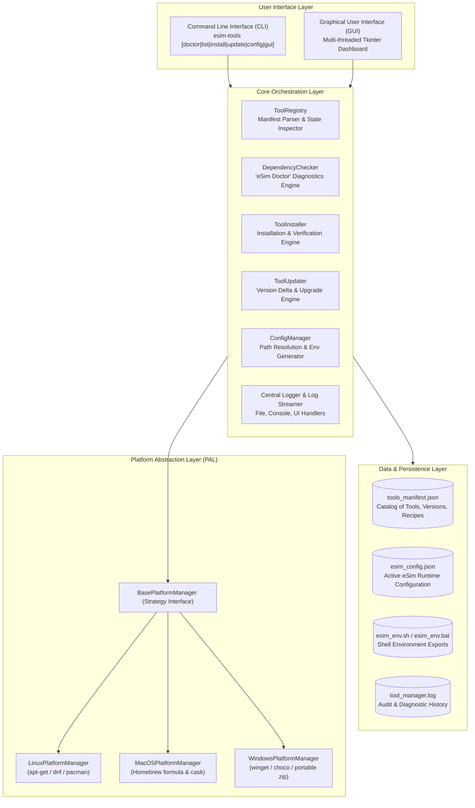
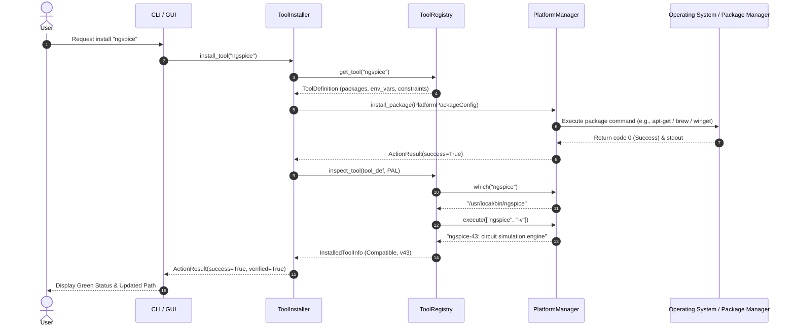
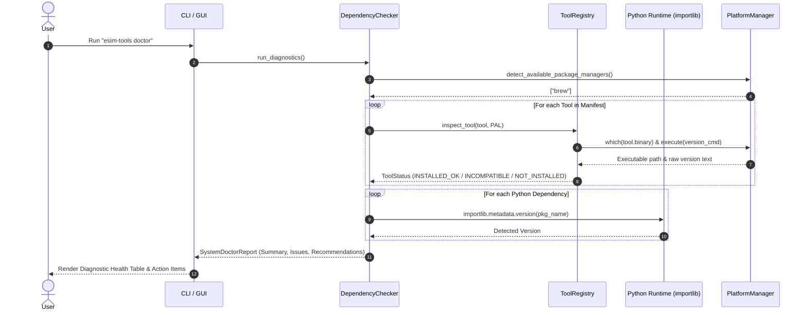

# Architectural Design Document: Automated Tool Manager for eSim

**Project Title:** Automated Tool Manager for eSim  
**Author / Engineering Team:** eSim Toolchain Architecture Team  
**Status:** Approved / Prototype Implemented  
**Target Platform:** Linux (Ubuntu/Debian, Fedora, Arch), macOS (Apple Silicon / Intel), Microsoft Windows (10/11)  
**Implementation Language:** Python 3.8+ (Zero external mandatory runtime dependencies)

---

## 1. Executive Summary & Problem Context

eSim (formerly Oscad) is an open-source EDA (Electronic Design Automation) simulation suite developed by FOSSEE at IIT Bombay. It orchestrates a complex ecosystem of diverse external open-source engineering tools:
* **KiCad (Eeschema & Pcbnew):** Schematic capture, symbol libraries, and PCB layout generation.
* **Ngspice:** Mixed-mode SPICE simulator engine for transient, AC, and DC circuit analysis.
* **GHDL:** VHDL simulator for digital design and mixed-signal co-simulation.
* **Verilator:** High-performance Verilog HDL compiler and simulator.
* **GTKWave:** Waveform viewer for digital/analog signal inspection (VCD, FST).
* **OpenModelica:** Equation-based multi-domain modeling environment.
* **Python Scientific Stack:** NumPy, SciPy, Matplotlib, SymPy, and PyQt/wxPython.

### The Problem
Historically, eSim users and workshop participants face major friction:
1. **Manual Installation Nightmare:** Each external tool relies on disparate installation mechanisms (APT packages on Ubuntu, DMG or Homebrew on macOS, multi-step zip/installer binaries on Windows).
2. **Version Fragility & Incompatibilities:** eSim requires specific version ranges (e.g., KiCad 6.x/7.x file format changes, Ngspice version 38+ with XSPICE code model support). Incompatible versions lead to silent netlist conversion errors or simulation crashes.
3. **Broken Path and Environment Variables:** eSim requires coordinated environment variables (`NGSPICE_PATH`, `SPICE_LIB_DIR`, `KICAD_CLI_PATH`, `VERILATOR_ROOT`). A missing PATH entry stops simulation workflows without informative errors.
4. **Lack of Self-Healing & Diagnostic Tools:** Users encounter cryptic GUI error dialogues with no automated way to diagnose whether the root cause is a missing shared library, an outdated binary, or a PATH misconfiguration.

### The Objective
The **Automated Tool Manager for eSim** provides a unified, cross-platform, manifest-driven engine that automates tool discovery, installation, version auditing, automated upgrades, environment configuration, and end-to-end dependency diagnostics ("eSim Doctor") via both a modern CLI and an intuitive Graphical User Interface (GUI).

---

## 2. Requirements Traceability Matrix

| Requirement Area | Specification | Implementation in eSim Tool Manager |
| :--- | :--- | :--- |
| **1. Tool Installation** | Automated download & installation of Ngspice, KiCad, GHDL, Verilator; cross-platform (Linux/Win/Mac); strict version verification. | `ToolInstaller` + `BasePlatformManager` adapters (`apt`, `brew`, `winget`, `choco`, direct archive extraction) + `VersionSpec` constraint engine. |
| **2. Update & Upgrade** | Remote update checks, automated upgrades with minimal manual intervention. | `ToolUpdater` querying package feeds and repository metadata, computing upgrade deltas. |
| **3. Configuration Handling** | Automated path detection, environment variable exports, eSim startup profiles, user overrides. | `ConfigManager` generating `esim_config.json`, `esim_env.sh` (POSIX), `esim_env.bat` (Windows), and `.env` files. |
| **4. Dependency Checker** | Comprehensive prerequisite validation (OS, system compilers, EDA binaries, Python runtime packages). | `DependencyChecker` ("eSim Doctor") evaluating system health and generating actionable remediation instructions. |
| **5. User Interface** | Simple, user-friendly CLI and GUI; inspection of installed versions, available updates, and structured action logs. | `esim_tool_manager.cli` (rich formatted tables) + `esim_tool_manager.gui` (multi-threaded, non-blocking Tkinter application) + `MemoryLogHandler`. |
| **Additional (Cross-Platform)** | Support Linux, macOS, and Windows with native package manager integration. | Modular Strategy Pattern: `LinuxPlatformManager`, `MacOSPlatformManager`, `WindowsPlatformManager`. |

---

## 3. High-Level System Architecture

The architecture is designed around clean separation of concerns, strict decoupling from specific operating systems, and an extensible, data-driven manifest.

---

## 4. Module Breakdown & Component Architecture

### 4.1 Data & Manifest Catalog (`esim_tool_manager/data/tools_manifest.json`)
Rather than hardcoding tool URLs and package names across Python files, all tool specifications are encapsulated in an extensible JSON manifest. Each entry defines:
* **Tool Identification:** `id`, `name`, `category`, `description`.
* **Binary Discovery:** Platform-specific binary filenames (`ngspice`, `kicad-cli`, `ghdl`, etc.).
* **Version Extraction:** CLI command (e.g. `["ngspice", "-v"]`) and regular expression pattern to parse semantic or milestone version strings.
* **Compatibility Range:** `min_version`, `max_version`, `recommended_version`.
* **Platform Packaging Recipes:** Specific package manager commands and fallback direct download archives for Linux (`apt`), macOS (`brew`), and Windows (`winget`/`choco`).
* **Environment Variables:** Templates resolving dynamic paths (`NGSPICE_PATH`, `SPICE_LIB_DIR`, `VERILATOR_ROOT`).

### 4.2 Platform Abstraction Layer (PAL) (`esim_tool_manager/platforms/`)
Implemented using the **Strategy Pattern**:
* **`BasePlatformManager`**: Defines the uniform contract:
  * `which(binary_name)`: Binary location discovery on system PATH and known platform directories.
  * `execute_command(cmd, timeout, env)`: Subprocess isolation with timeout safeguards, error capturing, and dry-run simulation support.
  * `install_package(pkg_config, tool_id)`: Platform installation execution.
  * `update_package(pkg_config, tool_id)`: Platform upgrade execution.
  * `query_online_version(pkg_config, tool_id)`: Remote upstream version discovery.
* **`LinuxPlatformManager`**: Auto-detects `apt`, `dnf`, or `pacman`; executes privilege elevation checks (`sudo` detection) and installs standard packages.
* **`MacOSPlatformManager`**: Integrates with Homebrew CLI (`brew install` and `brew install --cask` for GUI applications like KiCad); resolves standard `/Applications/KiCad.app` paths.
* **`WindowsPlatformManager`**: Integrates with Windows Package Manager (`winget`) and Chocolatey (`choco`); searches `%ProgramFiles%` and user-level portable installations.

### 4.3 Version Comparison Engine (`VersionSpec` in `core/models.py`)
EDA software releases do not always adhere strictly to SemVer (e.g. Ngspice releases as integers `38`, `42`, `43`; KiCad uses `7.0.11`; GHDL uses dates or tags).
The custom `VersionSpec` class provides:
* Component-wise integer tuple comparison (handles varying depth like `38` vs `38.2.1`).
* Constraint evaluation against standard operators: `>=`, `<=`, `>`, `<`, `==`, `!=`, and compound expressions (`>= 6.0, < 8.0`).
* Compatible release matching (`~= 6.0`).

### 4.4 Diagnostic Engine: eSim Doctor (`core/dependency_checker.py`)
Inspired by `flutter doctor` and `brew doctor`, this component conducts an automated multi-layer health inspection:
1. **OS & Architecture Layer:** Identifies kernel, architecture (x86_64 vs arm64/Apple Silicon), and available package managers.
2. **External EDA Binaries Layer:** Validates whether each required/optional tool is present on PATH, executes version validation commands, and flags version incompatibilities.
3. **Python Runtime Dependencies Layer:** Uses Python's standard `importlib.metadata` to verify that scientific computation packages (`numpy`, `scipy`, `matplotlib`, `sympy`) satisfy eSim's minimum version constraints.
4. **Actionable Remediation:** Compiles specific shell commands for the user to execute (or one-click auto-fix in GUI).

### 4.5 Configuration & Path Management (`core/config_manager.py`)
Resolves dynamic paths and exports unified configuration files:
* **`esim_config.json`**: Machine-readable JSON loaded by eSim during startup containing resolved tool paths, compatibility flags, and metadata.
* **`esim_env.sh`**: POSIX shell script exporting environment variables and prepending tool binary directories to `PATH`.
* **`esim_env.bat`**: Windows batch script setting environment variables for command-line simulations.
* **User Overrides:** Allows researchers to specify custom developer toolchains or SkyWater 130nm PDK paths without altering base configs.

---

## 5. Workflow Sequence Diagrams

### 5.1 Tool Installation Workflow

### 5.2 Diagnostic "eSim Doctor" Workflow

---

## 6. Security, Permissions, and Sandboxing Considerations

1. **Least-Privilege Execution:**
   - Package manager operations that require superuser permissions (e.g. `apt-get install`) explicitly detect whether the process is already root (`os.geteuid() == 0`). If not, commands are formatted with `sudo` prefix, prompting the user securely in standard terminal streams.
   - User-space package managers (Homebrew on macOS, portable zips or winget user-scope on Windows) run entirely unprivileged.
2. **Safe Subprocess Execution:**
   - Commands are passed as structured argument lists (`List[str]`), avoiding `shell=True` to eliminate shell injection vulnerabilities.
   - All subprocess calls feature strict execution timeouts (default: 180–360 seconds) to prevent frozen package manager hooks from locking up the system.
3. **Resilient Filesystem Access:**
   - Configuration management attempts to write to `~/.esim/`. If operating in a restricted sandbox or read-only home directory, it automatically falls back to `./.esim/` or the path defined by the `ESIM_HOME` environment variable.

---

## 7. Extensibility & Future Roadmap

Adding a new EDA tool (such as **SkyWater 130nm PDK**, **Magic VLSI**, or **Netgen LVS**) requires **zero code modifications**:
1. Add a new JSON object to `tools_manifest.json` under `"tools"`.
2. Specify binary name, version regex, compatibility constraints, and platform package recipes.
3. The Tool Manager immediately surfaces the new tool across CLI, GUI, diagnostics, installer, and configuration generators!

---

## 8. Summary of Achievements

The Automated Tool Manager solves the long-standing tooling setup friction in eSim by offering:
* **Zero External Dependencies:** Runs on pure standard Python 3.8+ (including standard library Tkinter).
* **Cross-Platform:** Native recipes for Linux, macOS, and Windows.
* **Self-Healing Diagnostics:** eSim Doctor pinpoints missing components and provides instant fixes.
* **Dual Interface:** Accessible via command-line scripting and graphical desktop UI.
* **Full Test Coverage:** 18 passing unit tests verifying registry parsing, platform abstraction, version comparisons, CLI operations, and config generators.
